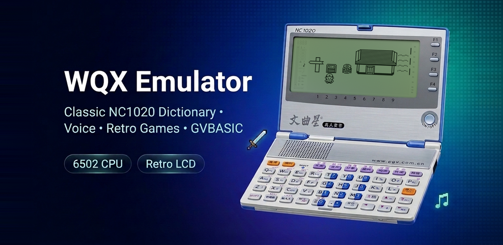
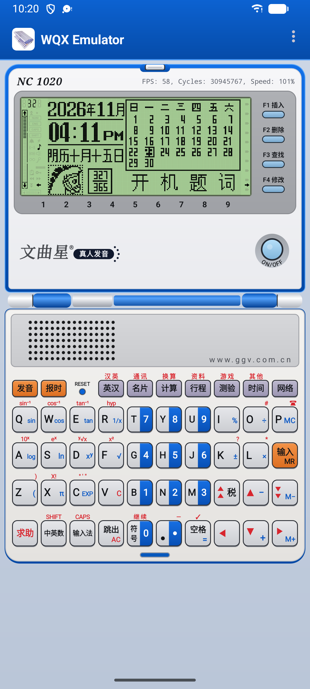
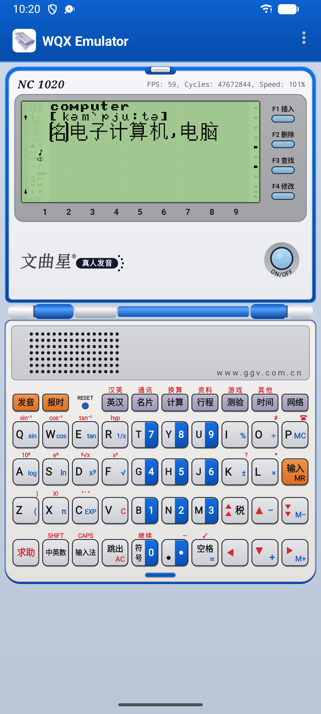
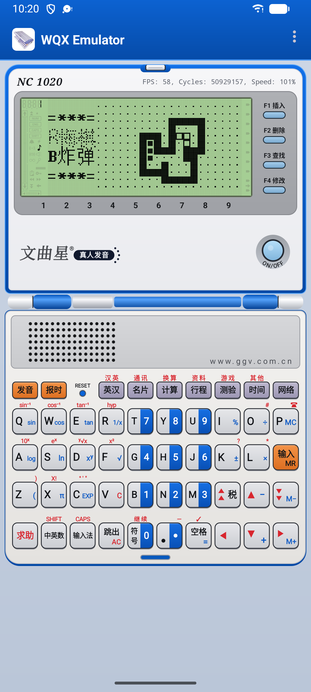
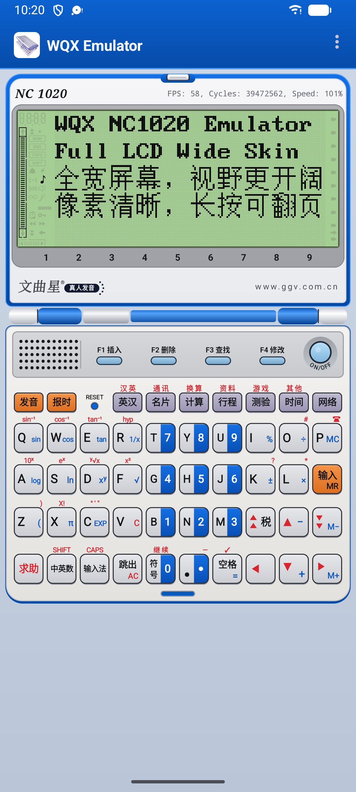
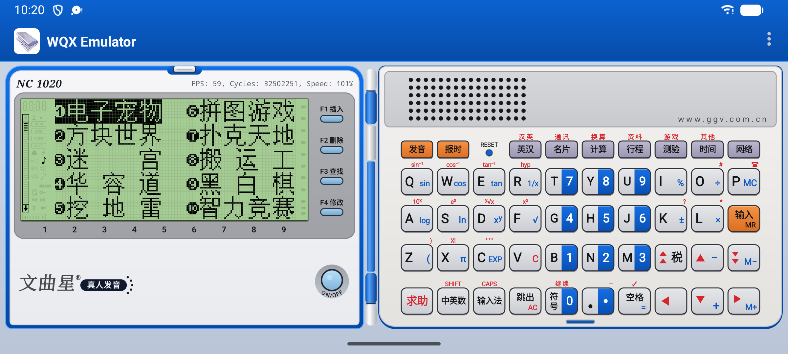
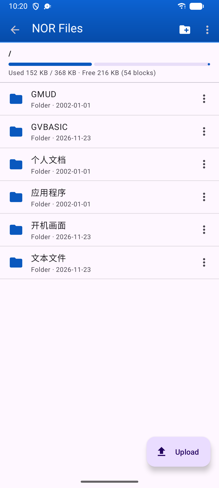
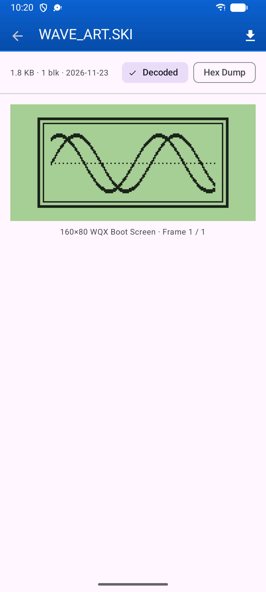
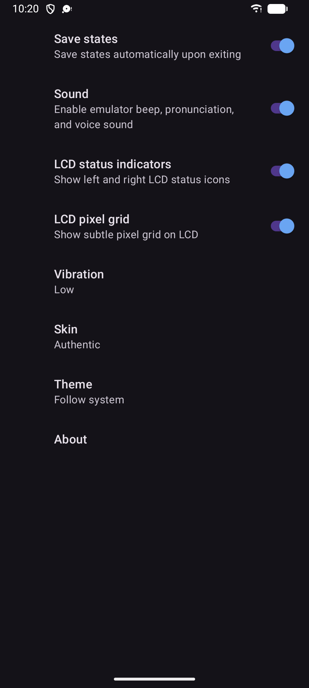

# WQX Emulator for Android (文曲星 NC1020 模拟器)



Bring the legendary **GoldenGlobal WQX NC1020 (文曲星)** pocket electronic dictionary, organizer, and retro gaming handheld back to life on Android — featuring a realistic NC1020 clamshell interface, selectable **Authentic** and **Full LCD** skins, fast cycle-paced native C emulation, and built-in Material 3 file tools.

Whether you want to look up words with authentic robotic English speech, tend your virtual pet, push crates in *Sokoban*, grind martial arts in *Legend of Heroes (黄金英雄坛说)* and *Exorcist (伏魔记)*, read `.txt` books in wide-screen **Full LCD** mode, or write `GVBASIC` programs on the go, **WQX Emulator** recreates the genuine NC1020 hardware experience down to the LCD status segments and key beeps.

---

## Screenshots

### Authentic Clamshell & Full LCD Skins

| Home Clock & Calendar | English–Chinese Dictionary | Classic Games (*Sokoban*) | Full LCD Skin (`文书浏览`) |
| :---: | :---: | :---: | :---: |
| [](arts/01_home_clock.png) | [](arts/02_english_dictionary.png) | [](arts/03_game_sokoban.png) | [](arts/05_ebook_reader.png) |
| **Authentic** skin with synced clock & lunar calendar | Phonetic lookup with `发音` voice synthesis | Built-in puzzle & RPG classics | **Full LCD** wide-screen skin for `.txt` e-books |

### Landscape Clamshell View

[](arts/04_landscape_mode.png)

*Side-by-side **Authentic** clamshell layout in landscape with the upper LCD bezel on the left and the tactile NC1020 keypad deck on the right.*

### NOR Flash File Manager & Customization

| NOR Flash File Browser | Built-in `.ski` / `.bas` / `.txt` Viewer | Dark Theme & Settings |
| :---: | :---: | :---: |
| [](arts/06_nor_file_browser.png) | [](arts/07_nor_file_viewer.png) | [](arts/08_dark_theme_settings.png) |
| Browse, upload, rename & export NOR files | Native preview for WQX graphics, BASIC & text | Customize **Skin**, LCD grid, status icons, haptics & theme |

---

## Key Features

- **Hardware-Accurate Native C Core**
  - Full 6502 CPU, bank-switched ROM/RAM, 512 KB `WQXFlashSX` NOR flash, real-time clock (RTC), timer IRQs, and keypad matrix emulation.
  - Automatic synchronization with your Android device's local date and time on startup.
- **Authentic NC1020 LCD Rendering**
  - Classic green dot-matrix LCD with **left and right hardware status segment columns** (7-segment counter, battery, speaker/melody, alarm, `SHIFT` / `CAPS` / `NUM` / `ENG` badges, scroll progress bar, and side page indicators) including subtle unlit ghost segments.
  - Optional **LCD pixel grid** overlay for a crisp retro dot-matrix look.
- **Low-Latency DSP & Beeper Audio**
  - Native AAudio / OpenSL ES audio pipeline supporting pitch-accurate key beeps, melodies, English word pronunciation (**发音**), and Mandarin voice time announcement (**报时**).
- **Realistic Clamshell Skins & Tactile Vector Keypad**
  - **Two selectable hardware skins** in Settings (**Skin**):
    - **Authentic** *(default)*: Faithful NC1020 silver/royal-blue clamshell frame with a 3D cylindrical hinge, speaker grille, side `F1–F4` pills, and `ON/OFF` power button in both **Portrait** and **Landscape**.
    - **Full LCD**: Expands the dot-matrix LCD across the full width of the upper lid for maximum viewing size while relocating `F1–F4` and `ON/OFF` into a matching brushed-silver control bar above the keypad.
  - Crisp vector-drawn NC1020 keycaps with **bounded aspect ratio** so keys preserve natural proportions across both standard and tall phone screens.
  - Release-triggered short taps prevent accidental mistouches, while **long-pressing (`>500ms`) holds the key down** continuously until released for smooth scrolling and game movement.
  - Configurable **haptic vibration feedback** (`Off`, `Low`, `Medium`, `High`) and a dedicated **Reset** pinhole button.
- **Built-in NOR Flash File Browser & Smart Codecs**
  - Inspect live 512 KB NOR storage usage, create standard WQX folders, browse directories, rename/delete entries, and preview or transfer files directly between Android and the WQX without PC serial tools:

  | File Type | Upload (Android → WQX NOR) | View & Export (WQX NOR → Android) |
  | :--- | :--- | :--- |
  | **Text (`.txt`)** | Converts UTF-8/GBK plain text into WQX `文书浏览` book format | Decodes GBK text & exports clean UTF-8 `.txt` |
  | **GVBASIC (`.bas`)** | Compiles plain-text BASIC source into NC1020 tokenized bytecode | Detokenizes bytecode into readable `GVBASIC` source |
  | **Graphics (`.ski`)** | Converts `PNG` / `JPG` images (`160×80`, optional Floyd–Steinberg dithering, crop & invert) | Renders static & animated `.ski` frames on a green LCD canvas; exports `PNG` or raw `.ski` |
  | **Apps / Games (`.bin`, etc.)** | Uploads WQX binaries (optional 16-byte PC transfer header stripping) | Inspects binary metadata & hex dump; exports raw binary |
  | **Full NOR Image (`.nor`)** | Imports 512 KB `WQXFlashSX` `.nor` backups | Exports full 512 KB `.nor` flash backups |

- **Quality-of-Life Controls**
  - **SpeedUp (Turbo) Mode** for fast-forwarding emulation.
  - Automatic and manual **Save / Load States**, plus one-tap **Factory Reset**.
  - **Material 3** UI with **Light**, **Dark**, and **Follow System** themes.

---

## Building from Source

### Prerequisites
- Android Studio (or JDK 17+ with Android SDK & NDK `29.0.14206865` / CMake)

### Build Commands

```bash
# Build debug APK
./gradlew assembleDebug

# Build release APK
./gradlew assembleRelease

# Build Google Play release App Bundle (.aab)
./gradlew bundleRelease
```

Or open the project root directly in **Android Studio** and run the `app` configuration on any Android 5.0+ (`minSdk 21`) device or emulator.

---

## Acknowledgments

Built upon [Banxian's C++ NC1020 sample & reverse-engineering documentation](https://github.com/banxian) and [hackwaly's `jswqx`](https://github.com/hackwaly/jswqx), with extensive native C rewrite, audio/LCD/timing accuracy improvements, NOR filesystem tooling, and Android UI enhancements.
